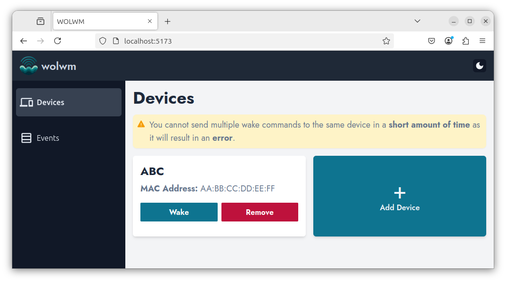
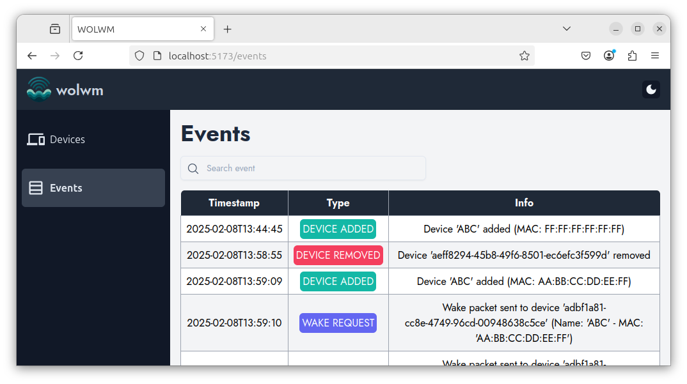

<!-- omit in toc -->
# WOLWM

<div align="center" style="text-align:center">
  <br>
  <a href=""></a>
  <br /><br/>
</div>

**WOLWM (Wake-on-LAN Web Manager)** is an easy-to-use web application that allows you to remotely wake up devices on your local network using **Wake-on-LAN (WoL) magic packets**. Its web interface is rendered directly by the Python backend, with no Node.js build toolchain or frontend framework.

## 🎯 Features

- 🌐 **Web-based Interface** – No need for CLI commands; manage Wake-on-LAN from a browser.
- ⚡ **Send Magic Packets** – Wake up devices remotely with a single click.
- 🗓️ **Scheduled Wake-ups** – Create one-time, daily, weekday, or weekly wake schedules in your local time zone.
- 📋 **Device Management** – Save and manage multiple devices for quick access.
- 🔄 **Logging & History** – Track which devices were woken up and when.

## 🔧 Setup

### Option 1: Running with Docker (Recommended)

1. Clone the repository:
   ```sh
   git clone https://github.com/thelicato/wolwm.git && cd wolwm
   ```
2. Create your configuration:
   ```sh
   cp .env.example .env
   ```
3. Start the application:
   ```sh
   docker compose up -d
   ```

### Option 2: Manual (dev mode)

1. Clone the repository:
   ```sh
   git clone https://github.com/thelicato/wolwm.git && cd wolwm
   ```
2. Run in development mode:
   ```sh
   task dev
   ```

## 🚀 Usage

1. Open your browser and navigate to `http://localhost:5000`
2. Add your device(s) by specifying a name and MAC address.
3. Click "Wake" to send a magic packet immediately, or open **Schedules** to automate it.

## ⚙️ Configuration

Configuration can be supplied through environment variables or a local `.env`
file:

| Variable | Description | Default |
| --- | --- | --- |
| `WOLWM_TIMEZONE` | IANA time zone used by new schedules, such as `Europe/Rome` | `UTC` |
| `WOLWM_WAKE_COOLDOWN_SECONDS` | Minimum wait between wake requests for the same device | `10` |
| `WOLWM_DATA_FOLDER` | Directory containing the SQLite database | `~/.wolwm` |

Changing `WOLWM_TIMEZONE` does not alter existing schedules; each schedule
retains the time zone in which it was created.


## 📷 Screenshots
|  |  |
| ------------------------------------- | ----------------------------------  |
| Devices Page                          | Events Page                         |

## 📌 Prerequisites

To use WOLWM, ensure you have:

- A device with **Wake-on-LAN** enabled in BIOS and OS.
- A **web server** to host the app.
- **Network access** to the target devices (they should be in the same subnet or properly routed).

## 📖 Wake-on-LAN Explained

Wake-on-LAN (WoL) is a networking standard that allows you to remotely wake up a powered-off computer using a **magic packet** sent over the network. The system must support WoL, and it must be enabled in both BIOS/UEFI and OS settings.

## 🛠️ Troubleshooting

- **Device not waking up?** Ensure WoL is enabled in BIOS and OS.
- **Magic packet not reaching the device?** Check firewall and network configurations.
- **Using a VPN?** Wake-on-LAN usually doesn’t work across different subnets without special routing.

## 🏗️ Future Improvements

- Add authentication.

## 📜 License

This project is licensed under the **MIT License**.

## ❤️ Contributing

Contributions are welcome! Feel free to open issues or submit pull requests on [GitHub](https://github.com/thelicato/wolwm).
